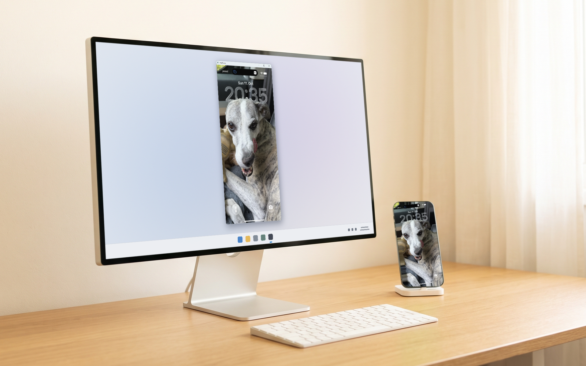
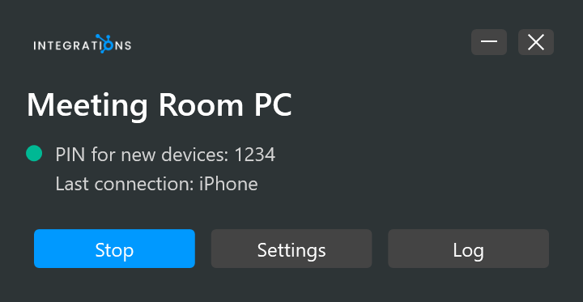

# AirPlay receiver

<table width="100%" border="1" cellpadding="10" cellspacing="0">
<tr>
<td align="left"><a href="../readme.md#features">← Back to Features</a></td>
<td align="center"></td>
<td align="right"><a href="settings.md">→ Next: Settings</a></td>
</tr>
</table>

The AirPlay receiver lets devices on your local network mirror their screen to this PC. Presenter Tools runs the bundled UxPlay engine, `uxplay.exe`, as a background process and restarts it if it stops. The receiver is off at first start and stays off until you turn it on.

| Section | Description |
| --- | --- |
| [Turn it on or off](#turn-it-on-or-off) | Pen bar, tray menu and status window controls |
| [Receiver name](#receiver-name) | The name devices see |
| [Who can connect](#who-can-connect) | Open, PIN and Password access |
| [Mirror window title](#mirror-window-title) | The device name in the mirror window's title |
| [Full screen](#full-screen) | Full screen mirroring |
| [Status window](#status-window) | What the status window shows and its buttons |
| [Errors and restarts](#errors-and-restarts) | Engine exits, missing files and the log |
| [Network](#network) | Firewall rules and subnet scope |

## Turn it on or off

- Click **AirPlay** on the pen bar. The button is highlighted while the receiver runs. Click it again to stop.
- Choose **Start receiver** or **Stop receiver** from the [tray menu](tray-icon.md).
- Click **Start** or **Stop** in the status window.

When you turn the receiver on from the pen bar or the tray menu, the status window appears for 5 seconds in the bottom-left corner of the pen bar's screen, without taking focus. If the status window is already open, it stays where it is.

If the receiver is running when you save Settings, it restarts with the new settings.

## Receiver name

Set the name in Settings > AirPlay. The name appears in Screen Mirroring on your devices. When the field is empty on save, the name is this PC's computer name.

## Who can connect

| Option | Behavior |
| --- | --- |
| Open | Any AirPlay device on your network can connect. |
| PIN | A new device enters a 4-digit PIN once. The status window shows the PIN. The PIN field starts with the saved PIN, or with a generated one when none is saved. Replace it with any 4 digits. |
| Password | A device enters the password. Settings does not save an empty password for this option. |

## Mirror window title

The mirror window's title shows the name of the device that is mirroring, for example "Alexander's iPhone". When another device connects, the title changes to that device's name.

## Full screen

Tick **Show mirrored screens full screen** in Settings > AirPlay to show mirrored screens full screen. The setting applies when the receiver starts.

## Status window

Open the status window from the tray menu with **Show receiver status**.

| Element | Meaning |
| --- | --- |
| Receiver name | The name from Settings |
| Status dot | Green: running. Amber: starting. Red: failed. Gray: stopped. |
| Access line | The PIN for new devices, **Password required**, or **Any AirPlay device on your network can connect** |
| Last connection | The device name, model and time of the most recent connection |
| Error line | The current problem, such as a missing engine or a restart notice |
| **Start** / **Stop** | Starts or stops the receiver |
| **Settings** | Opens the Settings window |
| **Log** | Opens `%LOCALAPPDATA%\PresenterTools\uxplay.log` in the default app |

The minimize button minimizes the status window. The close button hides it, and the receiver keeps running in the tray.

## Errors and restarts

- If `uxplay.exe` exits while the receiver is on, the status window shows the exit code and restarts the engine after 3 seconds.
- If the engine file is missing, the status window shows the expected path. Reinstall Presenter Tools to restore the file.
- The log file is rewritten each time the receiver starts.
- The engine stops when Presenter Tools exits.

## Network

The installer adds firewall rules for `uxplay.exe` on TCP and UDP. The rules allow traffic from the local subnet only, so devices outside the local subnet cannot connect.

---

<table width="100%" border="1" cellpadding="10" cellspacing="0">
<tr>
<td align="left"><a href="../readme.md#features">← Back to Features</a></td>
<td align="center"><a href="#airplay-receiver">↑ Back to top</a></td>
<td align="right"><a href="settings.md">→ Next: Settings</a></td>
</tr>
</table>
