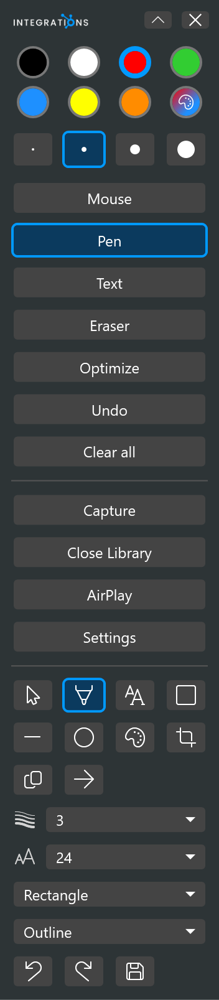
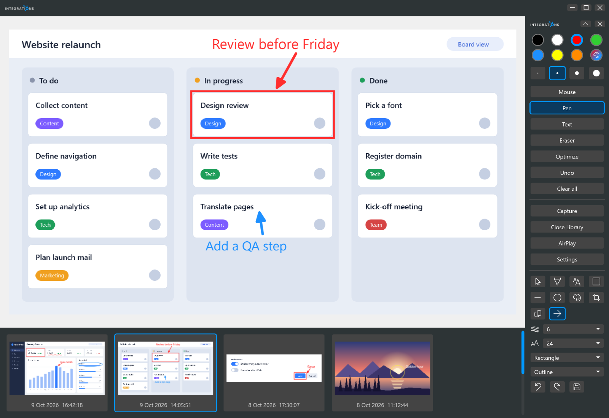
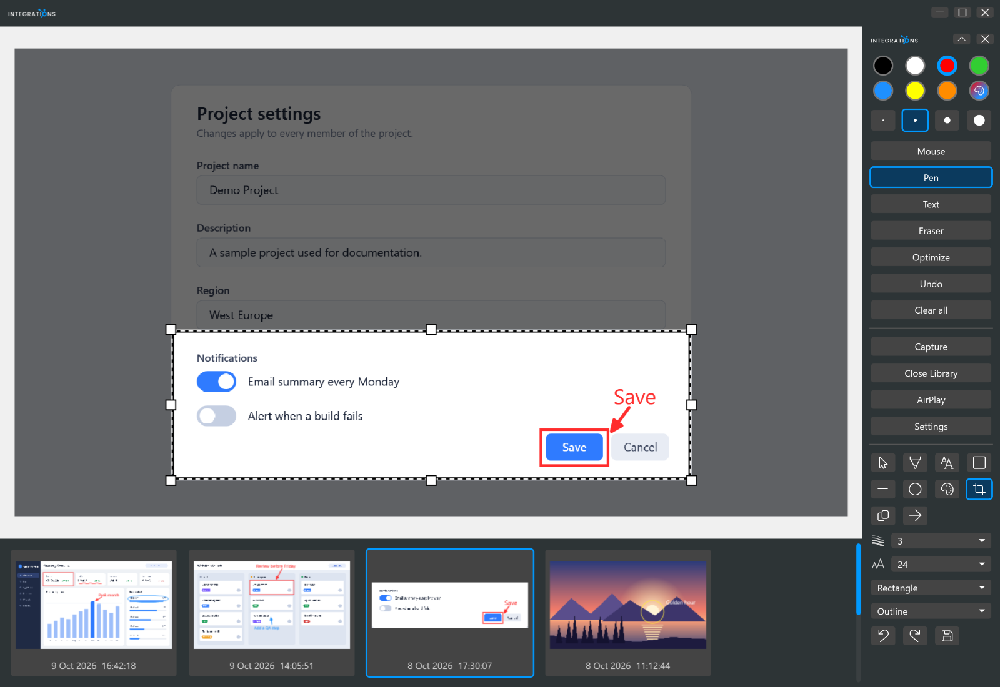

# Library editing tools

<table width="100%" border="1" cellpadding="10" cellspacing="0">
<tr>
<td align="left"><a href="../readme.md#features">← Back to Features</a></td>
<td align="center"></td>
<td align="right"><a href="airplay-receiver.md">→ Next: AirPlay receiver</a></td>
</tr>
</table>

These tools appear in the pen bar while the [library](library.md) is open. Use them to annotate, crop and export the capture you selected. Annotations and the crop are saved in the capture's JSON file, and the original PNG never changes.

## Tools

The panel shows the tools as a grid, then a row with **Copy image** and **Arrow**, then the Thickness, Font size, Shape kind and Shape style controls, and a bottom row with **Undo**, **Redo** and **Save**.

| Tool | How to use it |
| --- | --- |
| Select | Click an annotation to select it. A dashed blue outline shows the selection. Drag a selected annotation to move it. Zoom and pan work only with Select. The mouse wheel zooms the image from 1x to 16x around the pointer. When the image is zoomed, drag an empty area to pan. Zoom resets when you select a different capture. |
| Pen | Drag to draw freehand. |
| Text | Click where the text goes, type, and press Enter to finish. Clicking elsewhere also finishes it. Empty text is discarded. The text uses the selected font size and color. |
| Box | Drag to draw a rectangle outline. |
| Line | Drag to draw a straight line with round ends. |
| Shape | Drag to draw the selected shape kind in the selected style. For Polygon, click each point, then double-click or press Enter to finish. A polygon needs at least three points. |
| Fill | Click inside an area to fill the connected region of similar color with the selected color. |
| Crop | The full image appears with the outside area dimmed. The crop frame has a solid black line with a dashed white line inside it, and eight white handles on its edges and corners. Drag on the image to draw a new crop, or drag one of the handles to change the current crop. The crop is at least 16 pixels in each direction. Leaving Crop shows only the cropped area. A crop that covers the whole image removes the crop. |
| Arrow | Drag from the tail to the head. Selecting Arrow sets Thickness to 6. |

The library editor has no eraser. The eraser is part of the [pen bar](pen-bar.md).

## Settings

| Control | Options | Default |
| --- | --- | --- |
| Thickness | 1, 2, 3, 5, 6, 8, 12 | 3 |
| Font size | 12, 16, 20, 24, 32, 48, 64 | 24 |
| Shape kind | Rectangle, Rounded rectangle, Ellipse, Polygon | Rectangle |
| Shape style | Outline, Filled | Outline |
| Color | Follows the pen bar color | Red |

## Actions

**Copy image** sits in the row with Arrow. Its border flashes blue for a moment to confirm the copy. **Undo**, **Redo** and **Save** form the bottom row.

| Button | Shortcut | What it does |
| --- | --- | --- |
| Undo | Ctrl+Z | Reverses the last change, including crop changes |
| Redo | Ctrl+Y or Ctrl+Shift+Z | Repeats the last undone change |
| Save | Ctrl+S | Exports the capture with annotations and crop applied to a PNG file you choose. The dialog starts in the save location set in [Settings](settings.md#capture) and suggests a name like `screenshot-yyyyMMdd-HHmmss.png`. The library copy stays unchanged. |
| Copy image | Ctrl+C | Copies the same flattened image as the Copy image button |

Ctrl+Z, Ctrl+Y, Ctrl+Shift+Z and Ctrl+C do nothing while the cursor is in a text box, so the text box keeps its normal editing keys. Ctrl+S works everywhere in the library window. While the library is open, these shortcuts also work when the pen bar has focus, so you do not need to click into the library first. Enter finishes a polygon.

## Removing an annotation

The editor has no delete key. To remove a new annotation, press Undo. The undo history clears when you select a different capture or reopen the library, so you can undo only changes made since then.

---

<table width="100%" border="1" cellpadding="10" cellspacing="0">
<tr>
<td align="left"><a href="../readme.md#features">← Back to Features</a></td>
<td align="center"><a href="#library-editing-tools">↑ Back to top</a></td>
<td align="right"><a href="airplay-receiver.md">→ Next: AirPlay receiver</a></td>
</tr>
</table>
