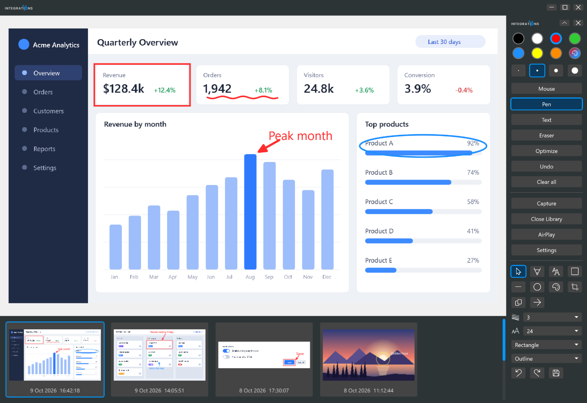

# Library

<table width="100%" border="1" cellpadding="10" cellspacing="0">
<tr>
<td align="left"><a href="../readme.md#features">← Back to Features</a></td>
<td align="center"></td>
<td align="right"><a href="library-editing.md">→ Next: Library editing tools</a></td>
</tr>
</table>

The library lists your captures in a gallery and shows the selected capture in a preview. It opens maximized, and the pen bar docks to its top-right corner while it is open. Each capture is stored as a PNG file with a JSON file next to it, in the save location set in [Settings](settings.md#capture).

## Open and close

- Click **Show Library** on the pen bar to open it. The button changes to **Close Library** while the library is open. Click it, or close the library window, to close the library.
- When the library is restored, it has the standard Windows title bar, border, shadow and resize edges. When it is maximized, it shows a dark header with a logo and minimize, restore and close buttons.
- Double-click the title bar or header to toggle maximize.
- Drag a maximized library by its header to restore it under the cursor and move it.
- Drag the title bar to the top edge of a monitor to maximize the library on that monitor (Aero Snap).
- Press Win+Shift+Left or Win+Shift+Right to move the library to the monitor on that side.

## Pen bar docking

While the library is open, the pen bar moves to the top-right corner of the library and follows the window when you move it, including to another monitor. The bar also shows the [library editing tools](library-editing.md) below its main section. When you close the library, the bar returns to where it was before.

## Gallery

- Thumbnails appear in one strip under the preview, newest first. Each thumbnail shows its date and time.
- The mouse wheel scrolls the gallery one row per notch.
- Drag the blue scrollbar to scroll. When you release it, the gallery snaps to the nearest row.
- Click a thumbnail to open that capture in the preview. The selected thumbnail has a blue border.
- Right-click the library body, outside text boxes, to hide the gallery and give the preview the full height. Right-click again to show the gallery.

Edits to a capture are written to its JSON file when you select a different capture or close the library. See [Library editing tools](library-editing.md).

## Where captures are stored

Captures go to the save location set in [Settings](settings.md#capture). The default is `%USERPROFILE%\Documents\ScreenShot\`. The library shows the folder that is set.

| File | Contents |
| --- | --- |
| `<save folder>\<timestamp>.png` | The captured image. It is written once and never changed by the library. |
| `<save folder>\<timestamp>.json` | The annotations and crop you added in the library |

The timestamp has the form `yyyyMMdd-HHmmss-fff`. The library lists only PNG files with that name format and ignores other files in the folder. The library has no delete command. To remove a capture, delete its PNG and JSON files in that folder.

---

<table width="100%" border="1" cellpadding="10" cellspacing="0">
<tr>
<td align="left"><a href="../readme.md#features">← Back to Features</a></td>
<td align="center"><a href="#library">↑ Back to top</a></td>
<td align="right"><a href="library-editing.md">→ Next: Library editing tools</a></td>
</tr>
</table>
