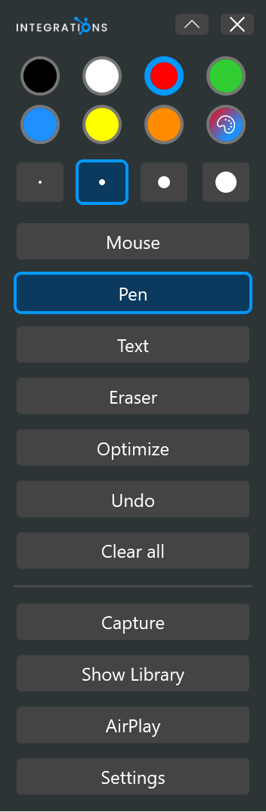

# Pen bar

<table width="100%" border="1" cellpadding="10" cellspacing="0">
<tr>
<td align="left"><a href="../readme.md#features">← Back to Features</a></td>
<td align="center"></td>
<td align="right"><a href="optimize.md">→ Next: Optimize</a></td>
</tr>
</table>

The pen bar is the floating toolbar that stays on top of your screens. Use it to pick a color and pen size, switch between mouse and drawing modes, and undo or clear ink. The ink layer covers all connected screens, so you can draw on any of them.

## Move, collapse and close

- Drag an empty part of the bar to move it. It starts at the top-left corner of the primary screen.
- Click the chevron button to collapse the bar. Only the header stays visible. Click it again to expand the bar.
- When the bar is collapsed, a **Minimize to tray** button appears. It hides the bar and switches to Mouse mode. Click the tray icon to show the bar again. See [Tray icon](tray-icon.md).
- The **X** button closes the app. The app exits, and the AirPlay receiver stops with it. To hide the bar and keep the app running, use **Minimize to tray** or the tray icon.

## Colors and pen sizes

| Control | Options | Default |
| --- | --- | --- |
| Palette | Black, white, red, green, blue, yellow, orange | Red |
| Custom color | Opens the Windows color dialog. The picked color becomes the custom swatch and is selected. | None |
| Pen size | 2, 4, 8, 14 | 4 |

The selected swatch and pen size show a blue border. The color applies to new pen strokes, text, and the library editing tools.

## Modes

| Mode | What it does |
| --- | --- |
| Mouse | The default at start. Clicks pass through the ink to the apps underneath, so you can use your computer normally. |
| Pen | Draw freehand with the selected color and size. |
| Text | Click on the screen to place a text box, type, and press Enter to place the text. Press Esc to cancel the box. Clicking elsewhere places the text and starts another box. Empty text is discarded. |
| Eraser | Drag over strokes to erase them whole. Drag over text to remove it. |

Switching modes commits any open text box. Selecting Mouse makes the ink click-through again.

## Undo and clear

- **Undo** reverses the last action: a stroke, a text box, an erase, an Optimize result, or a Clear all. The pen bar has no redo. Redo is available only in the library editor.
- **Clear all** removes all ink and text on every screen. You can undo a Clear all.

[Optimize](optimize.md) cleans up your last pen drawing. [Screen capture](screen-capture.md) saves a region of the screen. While the library is open, the pen bar also shows the [library editing tools](library-editing.md).

---

<table width="100%" border="1" cellpadding="10" cellspacing="0">
<tr>
<td align="left"><a href="../readme.md#features">← Back to Features</a></td>
<td align="center"><a href="#pen-bar">↑ Back to top</a></td>
<td align="right"><a href="optimize.md">→ Next: Optimize</a></td>
</tr>
</table>
