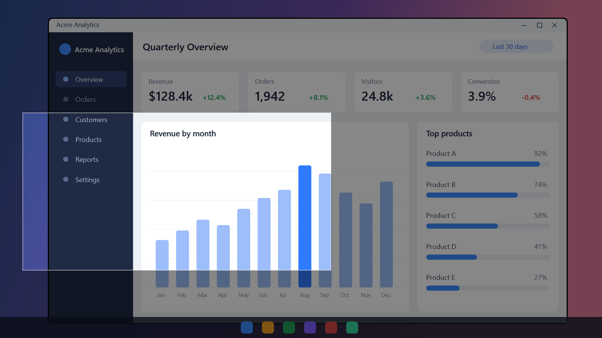

# Screen capture

<table width="100%" border="1" cellpadding="10" cellspacing="0">
<tr>
<td align="left"><a href="../readme.md#features">← Back to Features</a></td>
<td align="center"></td>
<td align="right"><a href="library.md">→ Next: Library</a></td>
</tr>
</table>

Presenter Tools captures a rectangle from your screens and saves it to the library. Start a capture with the **Capture** button on the pen bar or with a global shortcut, which is Print Screen by default. Each capture is saved as a PNG file and opens in the [library](library.md).

## Start a capture

| Method | When the capture starts |
| --- | --- |
| **Capture** button on the pen bar | 300 milliseconds after you click |
| Global shortcut | Immediately, from any app. Print Screen by default. |

Only one capture runs at a time. A second trigger while the selection is open does nothing.

## Select a region

1. The whole screen dims. Presenter Tools covers all connected screens.
2. Press the left mouse button and drag to draw the rectangle. The selected area stays bright and shows a thin white border.
3. Release the mouse button to capture the region. A selection less than 3 pixels wide or high is ignored, and the selection stays open.
4. Press Esc at any time to cancel. Nothing is saved.

The pen bar and any pen ink are hidden while the screen is captured and come back as they were when you finish or cancel the selection. Ink is only hidden, not cleared. An open library window stays visible and can appear in the capture.

## Where the capture goes

The selected region is saved as a PNG file in the save location set in [Settings](settings.md#capture). By default that is `%USERPROFILE%\Documents\ScreenShot\`. The library opens maximized and selects the new capture. Read [Library](library.md) for the file layout.

## Change the shortcut

1. Open [Settings](settings.md) and go to the **Capture** tab.
2. Click the shortcut field and press the keys you want. The field records the combination with Ctrl, Alt, Shift or Win plus one key. Print Screen works as a single key. A modifier key alone is not accepted.
3. Click **Save**.

Click **Reset to Print Screen** to restore the default. The status line under the field shows **Active** with the shortcut, or the reason it could not be registered.

If another app already holds the shortcut, for example another screenshot tool, Presenter Tools cannot register it. It shows a warning and the status line explains the conflict. Close the other app or choose a different shortcut.

---

<table width="100%" border="1" cellpadding="10" cellspacing="0">
<tr>
<td align="left"><a href="../readme.md#features">← Back to Features</a></td>
<td align="center"><a href="#screen-capture">↑ Back to top</a></td>
<td align="right"><a href="library.md">→ Next: Library</a></td>
</tr>
</table>
