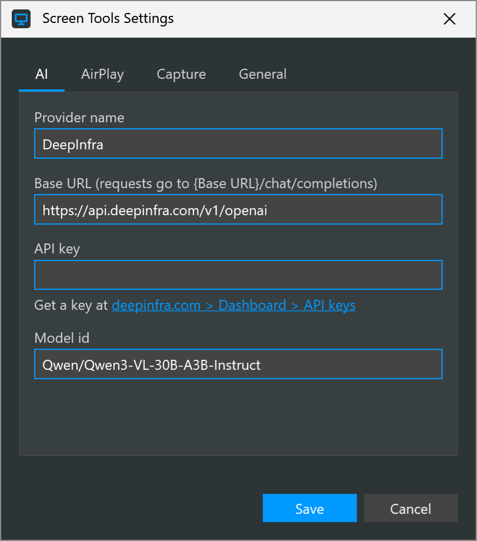
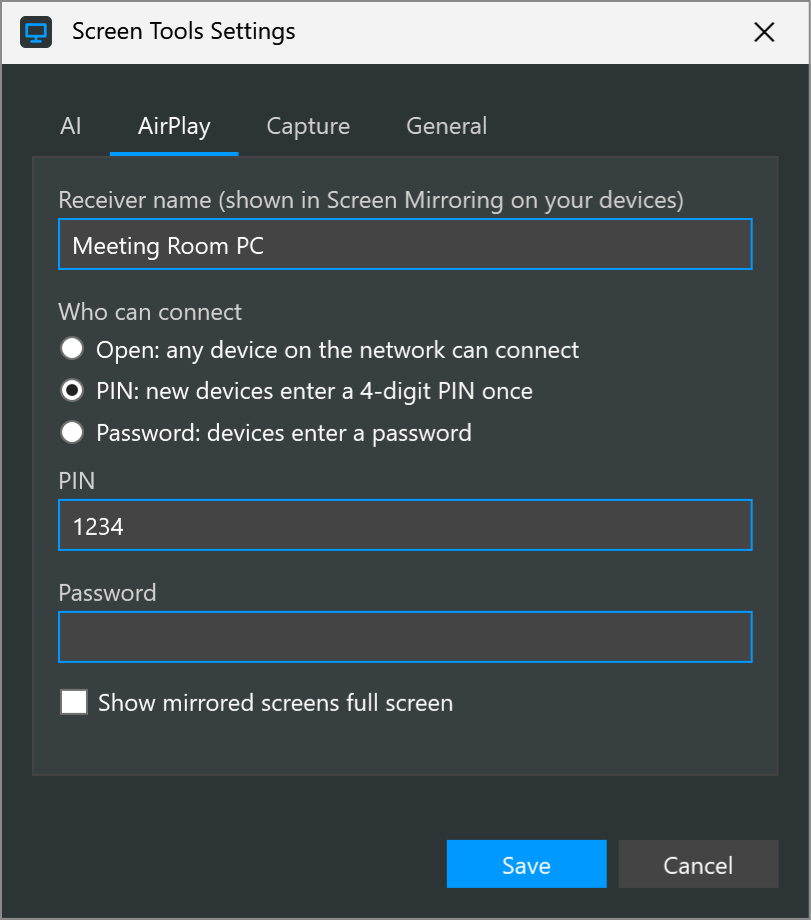
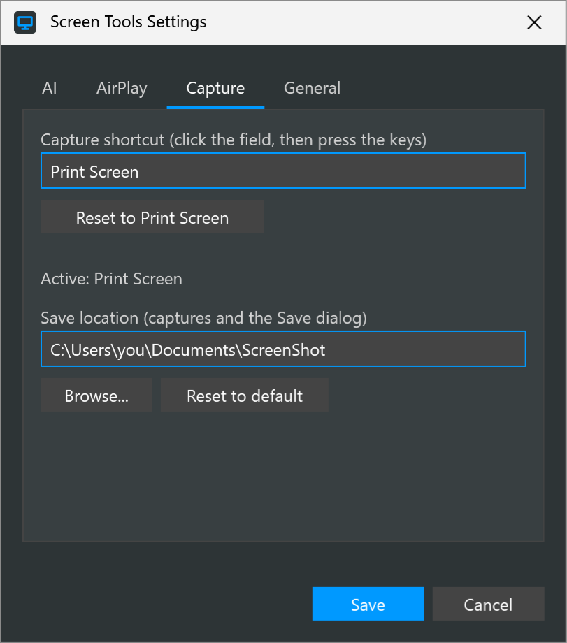

# Settings

<table width="100%" border="1" cellpadding="10" cellspacing="0">
<tr>
<td align="left"><a href="../readme.md#features">← Back to Features</a></td>
<td align="center"></td>
<td align="right"><a href="start-with-windows.md">→ Next: Start with Windows</a></td>
</tr>
</table>

The Settings window sets the AI provider, the AirPlay receiver, the capture shortcut and save location, and startup. Open it from the **Settings** button on the pen bar, the status window, or the tray menu. The window has four tabs: AI, AirPlay, Capture and General. **Save** applies all tabs at once, and **Cancel** discards your changes.

| Section | Description |
| --- | --- |
| [AI](#ai) | Provider, endpoint, key and model used by Optimize |
| [AirPlay](#airplay) | Receiver name, access rule, PIN, password and full screen |
| [Capture](#capture) | The shortcut that starts a capture, and where captures are saved |
| [General](#general) | Start with Windows |
| [Settings file](#settings-file) | Where settings are stored and how secrets are protected |

## AI

| Field | What it does | Default |
| --- | --- | --- |
| Provider name | A label for the provider. Presenter Tools stores it but does not use it in requests. | `DeepInfra` |
| Base URL | The root of an OpenAI-compatible API. Requests go to `{Base URL}/chat/completions`. | `https://api.deepinfra.com/v1/openai` |
| API key | The key sent with each Optimize request. The link below the field opens the DeepInfra key page at `https://deepinfra.com/dash/api_keys`. If the field is empty, the `DEEPINFRA_API_KEY` environment variable is used. | Empty |
| Model id | The model that reads the drawing. It must accept image input. | `Qwen/Qwen3-VL-30B-A3B-Instruct` |

See [Optimize](optimize.md) for what happens to the drawing.

## AirPlay

| Field | What it does | Default |
| --- | --- | --- |
| Receiver name | The name shown in Screen Mirroring on your devices. | This PC's computer name |
| Who can connect | **Open**, **PIN** or **Password**. See [AirPlay receiver](airplay-receiver.md). | Open |
| PIN | Four digits. Required when **PIN** is selected. | Saved PIN or a generated one |
| Password | Required when **Password** is selected. | Empty |
| Show mirrored screens full screen | Shows mirrored screens full screen when the receiver starts. | Off |

Save shows an error and opens this tab when the PIN is not four digits under PIN, or when the password is empty under Password.

## Capture

| Field | What it does | Default |
| --- | --- | --- |
| Capture shortcut | The key combination that starts a capture. Click the field and press the keys. | Print Screen |
| Reset to Print Screen | Restores the default shortcut in the field. Save applies it. | Not applicable |
| Save location | The folder where captures are stored and where the editor's Save dialog starts. The field is read-only. Use **Browse...** to change it. | `%USERPROFILE%\Documents\ScreenShot` |
| Browse... | Opens a folder picker. The chosen folder fills the Save location field. Save applies it. | Not applicable |
| Reset to default | Fills the Save location field with the default folder. Save applies it. | Not applicable |

The status line under the field shows whether the shortcut is active or why it could not be registered. See [Screen capture](screen-capture.md).

### Moving existing captures

When you click **Save** with a new save location and the old folder holds captures, Presenter Tools asks whether to move them to the new folder. Choose **Yes** to move each capture's PNG and JSON files. A capture whose file name already exists in the new folder is skipped and stays in the old folder. Nothing is deleted. Choose **No** to leave the files where they are. The library then shows only the new folder.

## General

| Field | What it does | Default |
| --- | --- | --- |
| Start with Windows (minimized in the system tray) | Starts Presenter Tools at sign-in with only the tray icon. See [Start with Windows](start-with-windows.md). | Off |

## Settings file

Presenter Tools saves settings to `%APPDATA%\PresenterTools\settings.json`. The file is created the first time you click **Save**. The `Capture` section stores the shortcut and `SaveFolder`, the save location.

The API key, the AirPlay PIN and the AirPlay password are encrypted for your Windows user account (DPAPI) and stored with a `dpapi:` prefix. Only your account on this PC can read them, so a copied file does not carry them to another user or PC. Values saved by an older version in plain text keep working and are encrypted the next time you click **Save**.

---

<table width="100%" border="1" cellpadding="10" cellspacing="0">
<tr>
<td align="left"><a href="../readme.md#features">← Back to Features</a></td>
<td align="center"><a href="#settings">↑ Back to top</a></td>
<td align="right"><a href="start-with-windows.md">→ Next: Start with Windows</a></td>
</tr>
</table>
