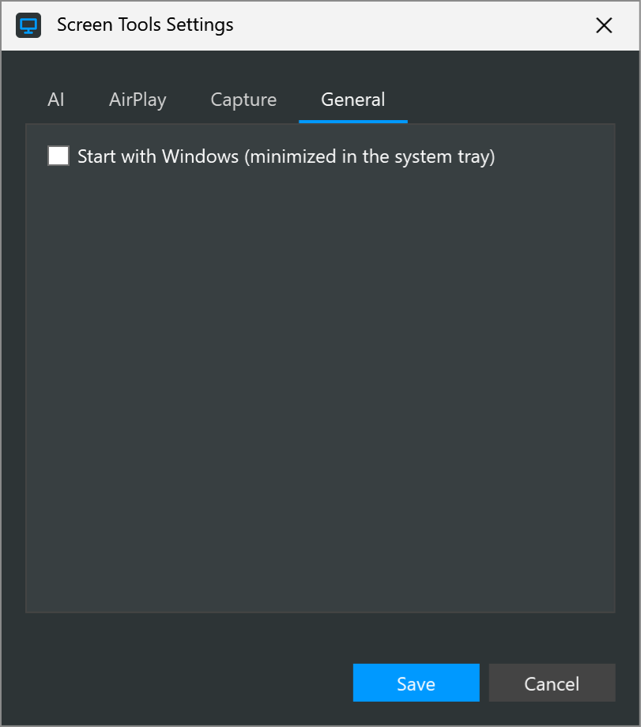

# Start with Windows

<table width="100%" border="1" cellpadding="10" cellspacing="0">
<tr>
<td align="left"><a href="../readme.md#features">← Back to Features</a></td>
<td align="center"></td>
<td align="right"></td>
</tr>
</table>

Start with Windows makes Presenter Tools open when you sign in. The app starts minimized to the tray, so only the tray icon appears and the pen bar stays hidden. The AirPlay receiver does not start on its own, so turn it on from the tray menu when you need it.

## Turn it on or off

| Where | How |
| --- | --- |
| Installer | Tick **Start Presenter Tools with Windows (minimized in the system tray)** on the Options page. The page appears on a new install only. |
| Settings | Tick the same option on the General tab, then click **Save**. |
| Tray menu | Tick **Start with Windows (minimized)**. |

Clear the option in any of these places to turn it off.

## What it changes

Start with Windows adds a value named `PresenterTools` under `HKCU\Software\Microsoft\Windows\CurrentVersion\Run`. The value runs `PresenterTools.exe --autostart` for the Windows account that set it. The entry stores the program's path. If you move the program, turn the option off and on again so the entry points to the new location.

## Uninstall note

The installer removes the entry only when you ticked the option during install. If you turned it on later, turn it off before you uninstall. See [Installation](../readme.md#uninstall).

---

<table width="100%" border="1" cellpadding="10" cellspacing="0">
<tr>
<td align="left"><a href="../readme.md#features">← Back to Features</a></td>
<td align="center"><a href="#start-with-windows">↑ Back to top</a></td>
<td align="right"></td>
</tr>
</table>
