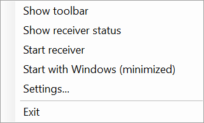

# Tray icon

<table width="100%" border="1" cellpadding="10" cellspacing="0">
<tr>
<td align="left"><a href="../readme.md#features">← Back to Features</a></td>
<td align="center"></td>
<td align="right"><a href="screen-capture.md">→ Next: Screen capture</a></td>
</tr>
</table>

The tray icon keeps Presenter Tools running when the pen bar is hidden. It sits in the notification area. Its tooltip reads **Presenter Tools**, or **Presenter Tools: <receiver name>** while the AirPlay receiver runs.

## Mouse actions

| Action | Result |
| --- | --- |
| Left-click | Shows the pen bar, or hides it if it is visible |
| Right-click | Opens the tray menu |

## Menu items

| Item | What it does |
| --- | --- |
| Show toolbar / Hide toolbar | Shows or hides the pen bar. The label matches the current state. |
| Show receiver status | Opens the [AirPlay receiver](airplay-receiver.md) status window |
| Start receiver / Stop receiver | Starts or stops the AirPlay receiver. The label matches the current state. |
| Start with Windows (minimized) | Turns [Start with Windows](start-with-windows.md) on or off |
| Settings... | Opens the [Settings](settings.md) window |
| Exit | Quits Presenter Tools and stops the AirPlay receiver if it runs |

Starting the app again does nothing, so the running copy keeps the only tray icon.

---

<table width="100%" border="1" cellpadding="10" cellspacing="0">
<tr>
<td align="left"><a href="../readme.md#features">← Back to Features</a></td>
<td align="center"><a href="#tray-icon">↑ Back to top</a></td>
<td align="right"><a href="screen-capture.md">→ Next: Screen capture</a></td>
</tr>
</table>
